<div align="center">

<h1>astro-stack-skills</h1>

<p><strong>From a ticket to reviewed, tested code, on one stack.</strong></p>

<p>8 skills · 1 command (<code>/verify</code>) · 4 hooks · 7 gates in a loop</p>

<p>


</p>

<p><a href="https://claude.ai/artifact/EZjLx2BqWtSBN2Qoajr6sE?sk=cCyeozeLvsW5lYgPlPhYqQ"><strong>📖 Guide: skill map, examples, install</strong></a></p>

<p><a href="#install">Install</a> · <a href="#skills">Skills</a> · <a href="#the-check-loop">Check loop</a> · <a href="#tech-stack">Tech stack</a> · <a href="#working-on-this-repo">Working on this repo</a></p>

</div>

<p align="center"><a href="docs/skill-map.svg"></a></p>
<p align="center"><sub>The skill map. Click it to open the full-size SVG and zoom in your browser.</sub></p>

Every change ends in the same loop: seven gates, then a review, then a report. Strict
**TypeScript**, **Effect** Schema for API data, **oRPC** through Effect services, **shadcn/ui**
components, and a story and tests for every state.

## Install

From the root of the project that will use the skills (or an empty folder), not in this repo.
Needs Node ≥ 18, git and SSH access to the GitLab.

```bash
npx git+ssh://git@gitlab.asoft-python.com/hoa.nguyen/astro-stack-skills.git init
```

This copies the skills, hooks and commands into `.claude/` and registers the hooks. Commit
`.claude/` so the whole team gets them. Later, `update` instead of `init` brings the latest `main`
and keeps your own edits (a file changed on both sides is merged like git). Add `--dry-run` to
either to see the changes first. `init --plugin` installs a plugin instead (skills then carry the
`/web-dev-stack:` prefix and cannot be edited in the project); use one way per project.

## Skills

| Skill | Use it to | Example |
|-------|-----------|---------|
| `analyze-task` | Turn a ticket, design or request into criteria, questions and a plan in `docs/tickets/<id>/` | `/analyze-task [design] /orders/new: order form` |
| `ticket` | Write one or more tickets' analysis and push it on its own branch for review | `/ticket 412 Filter /orders by status` |
| `code-skeleton` | Create the project, or bring an Astro repo up to the stack, with every gate passing | `/code-skeleton lunch-order http://localhost:8787` |
| `integrate-api` | Call oRPC through Effect services: Schema types, typed errors, retry, `load…`/`run…` helpers | `/integrate-api orders.list and orders.cancel` |
| `develop-feature` | Build one feature: server page, small islands, every state, stories, tests. A design is analysed first | `/develop-feature docs/tickets/412/` |
| `review-code` | Find duplicates, broken conventions and unproven criteria; fix and review again, ≤ 3 rounds | `/review-code` |
| `web-quality` | Audit and fix performance, Core Web Vitals, accessibility, SEO and security headers. The WCAG review uses the external [`accessibility`](https://github.com/addyosmani/web-quality-skills) skill when it is installed | `/web-quality Audit /orders` |
| `incident` | Write up a production incident (report, root cause, actions) and push it for review | `/incident INC-7 /orders 500s since 09:10` |

`/verify` is a command, not a skill: it runs the seven gates in a loop, then `review-code`. Each
skill's `SKILL.md` holds its full steps; `DESIGN.md` explains why it works that way.

## The check loop

`develop-feature`, `integrate-api` and `/verify` run these gates; a failure is fixed and the run
starts again at lint. Projects from `code-skeleton` have them all.

| Gate | Checks |
|------|--------|
| `lint` | ESLint, plus the [anti-slop](https://github.com/dmmulroy/anti-slop) Oxlint rules (no loose `unknown`, no `as unknown as`, Effect helpers over `_tag` checks) |
| `format:check`, `typecheck`, `test:coverage`, `build` | Prettier, `astro check`, Vitest with ≥ 80% coverage, the SSR build |
| `test:stories` | Every story in Chromium, light and dark: render errors, failing `play`, a11y violations |
| `test:pages` | Every page of the built site: SEO metadata, security headers and CSP, console errors, broken links, image alt and size, JS/CSS budget |

Four hooks run on their own: `turn-snapshot` (prompt sent), `post-edit-lint` (ESLint, anti-slop
and Prettier on each edited file), `protect-branches` (blocks pushes to `dev`, `stag`, `prod`) and
`task-checklist` (checklist of tasks, files and gates at the end of a turn).

## Tech stack

New projects pin each major. A repo on another major is reported, never changed; not `latest`
(Astro 7 and Effect 4 have other APIs). Source: `skills/code-skeleton/references/setup-layers.md`.

**Runtime and UI** (ships to users):

| Package | Version | Verified |
|---------|---------|----------|
| Node (server) | ≥ 22.19 | 22.23 |
| `astro` · `@astrojs/react` · `@astrojs/node` | 5 · 4 · 9 | 5.18 · 4.4 · 9.5 |
| `react`, `react-dom` | 19 | 19.3 |
| `effect` (Schema) | 3 (≥ 3.10) | 3.22 |
| `@orpc/client` | 1 | 1.15 |
| `tailwindcss`, `@tailwindcss/vite` | 4 | 4.3 |
| `shadcn` CLI (code copied into `src/`) | 4 | 4.22 |

**Dev tooling** (build, tests and checks only):

| Package | Version | Verified |
|---------|---------|----------|
| pnpm | 8, 10, 11 | 8, 11 |
| `typescript` (strictest) · `vite` | 5 · 6 | 5.9 · 6.4 |
| `vitest`, `@vitest/coverage-v8` · `jsdom` + Testing Library | 3 · 26 | 3.2 · 26.1 |
| `eslint` · `eslint-plugin-astro` | 9 · 1 | 9.39 · 1.7 |
| `oxlint`, `@oxlint/plugins` (exact; anti-slop rules vendored) | 1.78.0 | 1.78.0 |
| `prettier` · `prettier-plugin-astro` | 3 · 1 | 3.9 · 1.1 |
| `storybook` + addons · `@storybook-astro/framework` · `@vitejs/plugin-react` | 10 · 1 · 5 | 10.6 · 1.13 · 5.2 |
| `playwright` (Chromium, for `test:stories` and `test:pages`) | 1 | 1.64 |
| `husky` · `lint-staged` · `jscpd` | 9 · 16 · 4 | 9.1 · 16.4 · 4.3 |

`vite@^6` is pinned on purpose (otherwise a second Vite breaks the config). The `vitest@^4` peer
warning from `@storybook-astro/framework` is expected.

## Working on this repo

```bash
pnpm install     # also sets up the Git hooks
pnpm lint        # ESLint on bin/ and hooks/
pnpm test        # skill validation, hook and installer tests
pnpm validate    # claude plugin validate .
```

The README map is `docs/skill-map.svg`, the guide map's Export → SVG plus a `<style>` block and
dots at the end for the animation (cards appear in turn, edges flow, a dot runs along each edge;
all off with reduced motion). When a skill is added or renamed, export it again and copy that
style block and the dots across.

A commit runs ESLint and Prettier on staged files; a push runs lint, format and tests. Merge to
`main`: `update` reads `main`, and there is no version to bump. Try unpushed changes with
`update --source <path to your checkout>` or `claude --plugin-dir <this repo>`.

| Where | What |
|-------|------|
| `skills/<name>/` | `SKILL.md` and its `references/` (and `code-skeleton/assets/anti-slop/`, vendored) |
| `commands/`, `hooks/` | `/verify`; the four hooks and `hooks.json` |
| `bin/` | The `npx … init` / `update` installer |
| `spec.md`, `DESIGN.md`, `CLAUDE.md` | Intent; design decisions and why; the contract for projects using the skills |
| `docs/skill-map.svg` | The animated skill map in this README, exported from the guide's interactive map |
| [`astro-stack-playground`](https://gitlab.asoft-python.com/hoa.nguyen/astro-stack-playground) | A project built with the skills, with the headless run, gate logs and screenshots |
